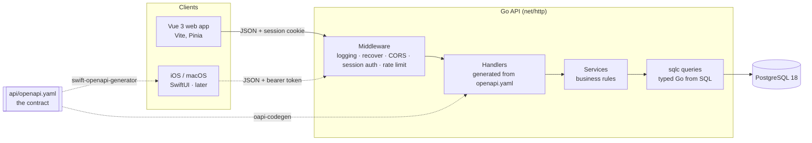

# How daybook was built (and what I learned)

> This is a living build log. Every milestone adds a chapter covering what was built, the concepts behind it, and the mistakes along the way. It's written so that someone new to the topic (including me, months from now) can follow it.

**Contents**
1. [What daybook is](#1-what-daybook-is)
2. [Architecture](#2-architecture)
3. [Decision log](#3-decision-log)
4. [Milestones](#4-milestones)
5. [Concepts glossary](#5-concepts-glossary)
6. [Resources](#6-resources)

---

## 1. What daybook is

daybook is my personal to-do app with a visual calendar: lists of tasks on kanban boards, plus a calendar and a "today" view showing what is scheduled and what is due. It started as **KanbanIA**, a university group project (Human Factors in Computing, with [Alejandro Penalba](https://github.com/APenalba)): a Vue front end with a fake, in-memory backend. I'm turning it into a real full-stack product to learn backend development, databases and cloud deployment from scratch.

**Roadmap**

| Step | What | Status |
|---|---|---|
| 1 | Planner web app + Go API + PostgreSQL, run locally | 🚧 in progress |
| 2 | Cloud hosting (VPS, Docker Compose, Caddy; frontend on Cloudflare) | planned |
| 3 | iOS app (SwiftUI) on the same API | planned |
| 4 | macOS app (same SwiftUI codebase) | planned |
| 5 | Budgeting app reusing the API, auth and infra patterns | planned |

**How to read this doc:** sections 2 and 3 give the big picture and the reasons behind it. Each chapter in section 4 can be read on its own. Words in *italics with a link* point to the glossary in section 5.

---

## 2. Architecture

### Life of a request (target design)
Here is what happens when the web app loads today's tasks with `GET /api/v1/tasks?due=today`:

1. **Browser**: the Vue app calls `fetch('/api/v1/tasks?due=today', { credentials: 'include' })`. The browser attaches the `session` cookie automatically. JavaScript can't read that cookie because it is `httpOnly` (see [sessions](#sessions-vs-tokens)).
2. **Vite dev proxy** (in development only) forwards `/api` to `localhost:8080`, so the browser sees one origin and there are no [CORS](#cors) problems.
3. **Middleware chain**: the request is logged (never the cookie), panics are recovered, and the session middleware hashes the cookie value, looks it up in `sessions`, and puts the user's id into the request's [`context`](#go-context).
4. **Validation**: the request is checked against `openapi.yaml`. A bad query parameter returns `400` with a problem+json body before any handler runs.
5. **Handler**: generated code calls my `ListTasks(ctx, params)` method with already-parsed, typed parameters.
6. **Service + query**: the service works out the user's "today" in their timezone and calls a sqlc-generated function. Its SQL always includes `WHERE user_id = $1`.
7. **Response**: rows are mapped to the API's JSON shape (camelCase) and written with status 200.

---

## 3. Decision log

Short records in the format *context → options → choice → why*. New decisions are appended and never rewritten. If a decision changes, add a new entry that supersedes the old one.

### D1 · Backend language: Go (2026-10-23)
- **Context:** I need an API for web now and native apps later. I'm also learning backend development.
- **Options:** Node + TypeScript (Fastify), or Go.
- **Choice:** Go.
- **Why:** I learn a second language that is widely used for backends and infrastructure. It compiles to a single static binary, so the Docker image in step 2 is tiny. The standard library alone covers HTTP, JSON, logging and testing. The trade-off is that Go is more verbose than TypeScript and the frontend and backend can't share types; the OpenAPI spec (D2) solves the type-sharing part.

### D2 · API contract: spec-first OpenAPI (2026-10-23)
- **Context:** Three clients (web, iOS, macOS) need to agree on one API.
- **Options:** *Spec-first*: hand-write `openapi.yaml`, then generate server stubs (`oapi-codegen`) and clients from it. *Code-first*: write Go handlers and let a framework such as **Huma** generate the spec.
- **Choice:** spec-first, with a Huma comparison spike after M2.
- **Why:** writing the spec by hand makes me design the API (resources, status codes, error shapes) before coding it, which is the skill I want to learn. The same file generates the Swift client in step 3. Code-first is faster day to day and is common in industry, so I'll build a few endpoints with Huma on a throwaway branch and record the comparison here.

### D3 · Database: PostgreSQL over SQLite (2026-10-23)
- **Why:** I'll use the same database locally, in the cloud and in the budgeting app. It has real `timestamptz`, `CHECK` constraints and `uuidv7()` (new in Postgres 18), and it is what most companies run. SQLite would be simpler locally but would need a migration later.

### D4 · Data access: sqlc + goose, not an ORM (2026-10-23)
- **Why:** I write plain SQL (which teaches me SQL), and sqlc generates type-safe Go functions from it, so a typo in a column name fails at build time rather than at runtime. Goose runs [migrations](#migrations) that are plain `.sql` files committed to Git. An ORM like GORM hides the SQL, which is the part I want to learn.

### D5 · Auth: server-side sessions in a cookie (2026-10-23)
- **Why:** a random token is stored *hashed* in a `sessions` table and sent as an `httpOnly; Secure; SameSite=Lax` cookie. Logging out or revoking a session deletes a database row. JWTs can't be revoked before they expire without extra machinery. Mobile apps will send the same kind of token as a `Bearer` header, backed by the same table. See [sessions vs tokens](#sessions-vs-tokens).

### D6 · Ordering tasks: integer positions with gaps (2026-10-23)
- **Why:** positions go 1000, 2000, 3000… so moving a task between two others gives it the midpoint (e.g. 1500), which updates one row. When there's no gap left, that column is renumbered inside a [transaction](#transactions). The alternative, fractional-index strings, never needs renumbering but is harder to read in `psql`.

### D7 · Visual identity: Ivory/Fern light, Dim Grey/Lavender dark (2026-10-23)
- **Why:** a calm, natural palette for an app that stays open all day. Measured contrast changed how the colours are used: small Fern text on Ivory fails WCAG AA (3.83:1), so small text and buttons use a darker *Fern Deep*. Lavender on Dim Grey is about 4.1:1, so the dark page uses a deeper grey and Dim Grey becomes the card colour. Details: [STYLE_GUIDE.md](STYLE_GUIDE.md).

---

## 4. Milestones

Every chapter uses the same template: **Goal · What I built · Concepts · Try it yourself · Gotchas · What I'd do differently**.

### M0 · Repo prep
*Status: not started*

- **Goal:** turn a single Vue app into a monorepo with `web/` and `server/` folders, and add shared tooling.
- **What I built:** _(to be filled in)_ Renamed the project to **daybook**, moved the Vue app with `git mv`, set up npm workspaces for `web/`, a Go module in `server/`, and a root Makefile.
- **Concepts:** _`git mv` and why it keeps file history · monorepos and workspaces · `.editorconfig` / `.nvmrc`_
- **Try it yourself:** _(commands)_
- **Gotchas:** renaming the GitHub repo redirects Git URLs but **not** GitHub Pages, so Vite's `base` path had to change from `/FH-p4-b3/` to `/daybook/`.
- **What I'd do differently:** _(to be filled in)_

### M1 · Local database
*Status: not started*

### M2 · API
*Status: not started*

### M3 · Frontend on the real API
*Status: not started*

### M4 · Planner pivot
*Status: not started*

### M5 · GitHub-ready demo
*Status: not started*

---

## 5. Concepts glossary

Short explanations that the chapters link to. Each one should make sense on its own.

### Migrations
Versioned, ordered SQL files that change the database schema (`001_create_users.sql`, `002_add_tasks.sql`…). The database records which ones have already run, so every environment (my laptop, CI, the server) ends up with exactly the same schema by running "all migrations not yet applied". They are committed to Git like code.

### Transactions
A group of SQL statements that succeed or fail together (`BEGIN … COMMIT`, or `ROLLBACK` on error). Moving a task changes its column and also shifts other tasks' positions. Without a transaction, a crash halfway through could leave two tasks in the same position.

### Sessions vs tokens
A *session* is state stored on the server (a row in `sessions`), and the client holds only a random ID. A *self-contained token* (JWT) carries the user's data, signed by the server. Sessions are easy to revoke and keep secrets off the client. JWTs avoid a database lookup per request but are hard to revoke. We store only a **hash** of the session ID, so a leaked database dump can't be used to log in.

### CORS
Browsers block JavaScript on `site-a.com` from reading responses from `api.site-b.com` unless the API sends `Access-Control-Allow-Origin` headers. In development, the Vite proxy makes the frontend and API share one origin, so CORS isn't needed; it is only enabled for the dev origin as a fallback.

### Go context
`context.Context` is passed as the first argument through every layer of a request. It carries a deadline or cancellation signal (if the browser disconnects, the database query is cancelled too) and request-scoped values such as the authenticated user's id.

_(More entries are added with each milestone: indexes, argon2, OpenAPI, Go interfaces, error wrapping, goroutines, …)_

---

## 6. Resources

- [Go tour](https://go.dev/tour/) and [Effective Go](https://go.dev/doc/effective_go)
- [OpenAPI 3.1 specification](https://spec.openapis.org/oas/v3.1.0)
- [oapi-codegen](https://github.com/oapi-codegen/oapi-codegen) · [sqlc](https://docs.sqlc.dev/) · [goose](https://github.com/pressly/goose) · [pgx](https://github.com/jackc/pgx) · [Huma](https://huma.rocks/)
- [PostgreSQL documentation](https://www.postgresql.org/docs/)
- [RFC 9457: Problem Details for HTTP APIs](https://www.rfc-editor.org/rfc/rfc9457)
- [WCAG 2.2 contrast minimum](https://www.w3.org/WAI/WCAG22/Understanding/contrast-minimum.html)
