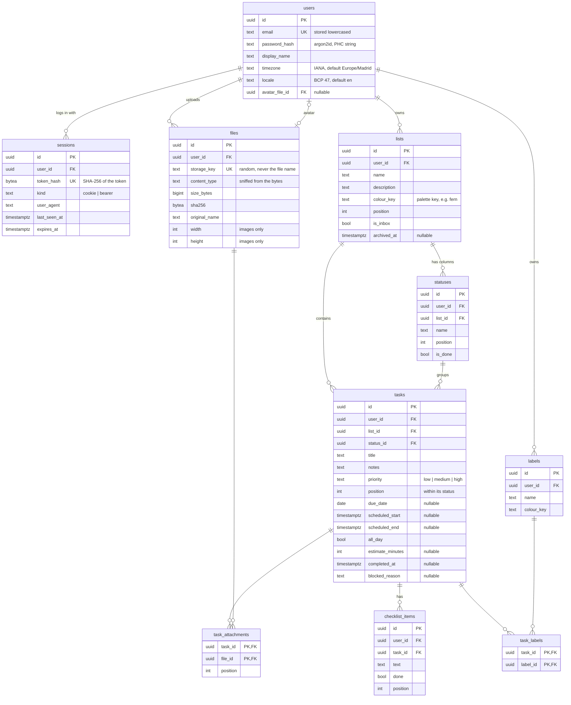

# Data model

The PostgreSQL schema for daybook, designed before any code exists. The real thing will be the goose migrations in `server/internal/db/migrations/` (M2). If they disagree with this page, update this page.

## Diagram

Every table except the two join tables also has `created_at` and `updated_at` (`timestamptz`, default `now()`). They're left out of the diagram to keep it readable.

## Rules that apply everywhere
- **IDs are UUIDv7** (`DEFAULT uuidv7()`, new in Postgres 18). They're random enough that one user can't guess another's IDs, but they're ordered by time, so indexes stay compact. Plain random UUIDv4 scatters inserts all over the index.
- **Every user-owned row carries `user_id`**, even child rows like statuses and checklist items. Every query filters by it. That makes "can user A see user B's task?" a question the SQL answers, not something each handler has to remember.
- **Composite foreign keys keep children inside their owner.** `lists` has `UNIQUE (id, user_id)`, and statuses reference `(list_id, user_id) → lists(id, user_id)`. A status can't point at another user's list even if the code has a bug. Tasks do the same with lists, and use `(status_id, list_id) → statuses(id, list_id)` so a task's status always belongs to the task's own list.
- **Times:** moments are `timestamptz` (stored as UTC). Calendar days are `date`. "Today" is worked out in the user's `timezone`.
- **Colours are palette keys** (`fern`, `sky`, …), not hex. See [0013](../decisions/0013-colour-keys.md).
- **Ordering** uses integer `position` with gaps of 1000. See [0006](../decisions/0006-position-gaps.md).
- **`updated_at`** is set explicitly in each `UPDATE` query (`updated_at = now()`). A trigger would also work. That decision is made in M2.

## Table notes

| Table | Delete behaviour | Indexes and checks |
|---|---|---|
| `users` | Deleting a user cascades to everything they own. `avatar_file_id` is `ON DELETE SET NULL`. | `UNIQUE (lower(email))` |
| `sessions` | `CASCADE` with the user. Expired rows are cleaned up by a periodic job. | `UNIQUE (token_hash)`, index on `user_id`, `CHECK (kind IN ('cookie','bearer'))` |
| `files` | `CASCADE` with the user. **Deleting a row doesn't delete the bytes in storage**, so the delete endpoint removes both, and a cleanup job catches leftovers. See [files and images](files-and-images.md). | `UNIQUE (storage_key)`, index on `user_id`, `CHECK (size_bytes > 0)` |
| `lists` | `CASCADE` with the user. | `UNIQUE (id, user_id)`, index on `(user_id, position)`, one inbox per user: partial unique index on `(user_id) WHERE is_inbox` |
| `statuses` | `CASCADE` with the list. | `UNIQUE (id, list_id)`, index on `(list_id, position)` |
| `tasks` | `CASCADE` with the list. A status can't be deleted while tasks use it (`RESTRICT`): the API asks which status to move them to. | `CHECK (priority IN (...))`, `CHECK (scheduled_end > scheduled_start)`, `CHECK (estimate_minutes > 0)`, indexes on `(status_id, position)`, `(user_id, scheduled_start)`, `(user_id, due_date)` |
| `labels` | `CASCADE` with the user. | `UNIQUE (user_id, lower(name))` |
| `task_labels` | `CASCADE` from both sides. | PK `(task_id, label_id)`, index on `label_id` |
| `checklist_items` | `CASCADE` with the task. | index on `(task_id, position)` |
| `task_attachments` | `CASCADE` from both sides. | PK `(task_id, file_id)`, index on `file_id` |

## Later (designed for, not in the first migrations)
- `tasks.recurrence_rule text`: an iCalendar RRULE such as `FREQ=WEEKLY;BYDAY=MO`.
- `reminders`: `task_id`, `remind_at timestamptz`, `channel` (`push`, `email`), `sent_at`.
- `task_notes`: a running log on a task, replacing KanbanIA's comments.

## What changed from KanbanIA
- Boards became **lists**. Members, owners and avatars of other people are gone.
- The single `checklist` object (and `BoardView`'s `checklists: []`) became one `checklist_items` table.
- `labels` were hex strings on each task. Now they're rows, shared across lists, linked through `task_labels`.
- `timeEstimation` in hours became `estimate_minutes` (an integer, so no rounding problems).
