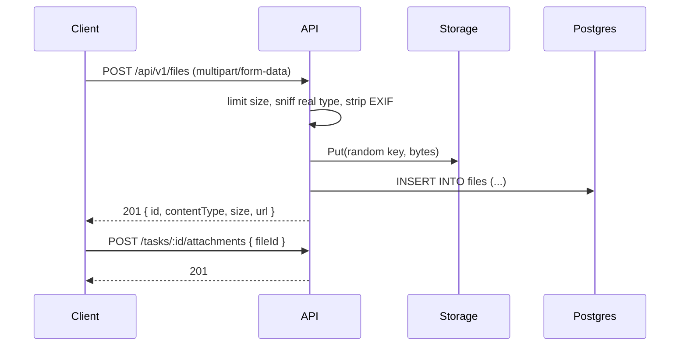

# Files and images

Task attachments (images, PDFs) and profile pictures. Designed now, built in **M4**, moved to cloud storage in **step 2**. Decision record: [0011](../decisions/0011-file-storage.md).

## Where the bytes live
**The database never stores the file itself.** Postgres keeps a small *metadata* row in `files`: owner, size, type, original name, a checksum, and a `storage_key`. The bytes go to **object storage**, a service built to hold large blobs cheaply:

| Environment | Storage | Where |
|---|---|---|
| Local dev (step 1) | `localfs` | `var/uploads/` in the repo, gitignored |
| Production (step 2) | `s3` | Cloudflare R2, which speaks the Amazon S3 API |

Why not put the bytes in Postgres (`bytea`)? It works for a few small files, but every backup, restore and replica copies all of them. Large rows also slow down queries and use the database's memory. Object storage is cheaper per GB and can hand files to clients directly.

## One interface, two implementations
The rest of the server only knows this Go **interface**: a set of methods that any type can satisfy. Config picks which implementation is created at startup, so swapping local disk for R2 is a config change, not a code change.

```go
type Storage interface {
    Put(ctx context.Context, key string, r io.Reader, contentType string) error
    Open(ctx context.Context, key string) (io.ReadCloser, error)
    Delete(ctx context.Context, key string) error
    URL(ctx context.Context, key string, ttl time.Duration) (string, error)
}
```

Tests use the `localfs` version pointed at a temporary folder (`t.TempDir()`).

## Upload: how a file gets in



1. **Size limit first.** `http.MaxBytesReader` stops reading after 10 MB, so a huge upload can't fill the disk or memory. The API answers `413 file.too_large`.
2. **Real type, not the claimed one.** The browser's `Content-Type` can be faked. The server reads the first bytes (`http.DetectContentType`) and accepts only an allow-list: JPEG, PNG, WebP, GIF, PDF. **No SVG or HTML**, because they can carry scripts.
3. **Strip EXIF from photos.** Phone photos often contain the GPS location where they were taken. Re-encoding the image removes it.
4. **Random storage key** (`u/<userId>/<uuid>`), never the original file name. User-chosen names could collide or contain `../`.
5. **Two-step link.** Uploading creates a `files` row; attaching it to a task (or setting it as the avatar) is a separate call. The same upload code works for every feature.

## Download: how a file gets out
The API never returns a permanent public link. Each file in a response has a `url` that only works for a short time:
- **Dev:** `/api/v1/files/:id/content`. The API checks the session owns the file, then streams it from disk.
- **Production:** a **presigned URL** from R2, signed with a secret and valid for 15 minutes. The browser downloads straight from R2, and the API isn't in the path.

Clients treat both kinds of URL the same, so nothing changes for the web or iOS apps when storage moves to R2. Responses always send `X-Content-Type-Options: nosniff`, and anything that isn't an image is sent as `Content-Disposition: attachment` (downloaded, never rendered in the page).

## Deleting
`DELETE /files/:id` removes the bytes from storage and then the row. If the server crashes in between, an orphaned blob is left behind. A periodic cleanup job compares storage keys with `files` rows and removes leftovers.

## Later, when there are many or large files
- **Direct uploads:** the API hands out a presigned *upload* URL, the client sends the file straight to R2, then tells the API it's done. Uploads stop passing through the server.
- **Thumbnails** generated in a background job, so lists of images load fast.
- **Per-user storage quota**, using `SUM(size_bytes)`.

Security checklist for this feature: [security/files.md](../security/files.md).
