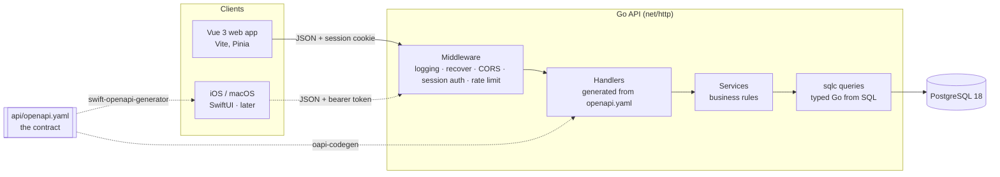

# Architecture overview

## Life of a request (target design)
Here is what happens when the web app loads today's tasks with `GET /api/v1/tasks?due=today`:

1. **Browser**: the Vue app calls `fetch('/api/v1/tasks?due=today', { credentials: 'include' })`. The browser attaches the `session` cookie automatically. JavaScript can't read that cookie because it is `httpOnly` (see [sessions](../concepts/security.md#sessions-vs-tokens)).
2. **Vite dev proxy** (in development only) forwards `/api` to `localhost:8080`, so the browser sees one origin and there are no [CORS](../concepts/http.md#cors) problems.
3. **Middleware chain**: the request is logged (never the cookie), panics are recovered, and the session middleware hashes the cookie value, looks it up in `sessions`, and puts the user's id into the request's [`context`](../concepts/go.md#go-context).
4. **Validation**: the request is checked against `openapi.yaml`. A bad query parameter returns `400` with a problem+json body before any handler runs.
5. **Handler**: generated code calls my `ListTasks(ctx, params)` method with already-parsed, typed parameters.
6. **Service + query**: the service works out the user's "today" in their timezone and calls a sqlc-generated function. Its SQL always includes `WHERE user_id = $1`.
7. **Response**: rows are mapped to the API's JSON shape (camelCase) and written with status 200.
