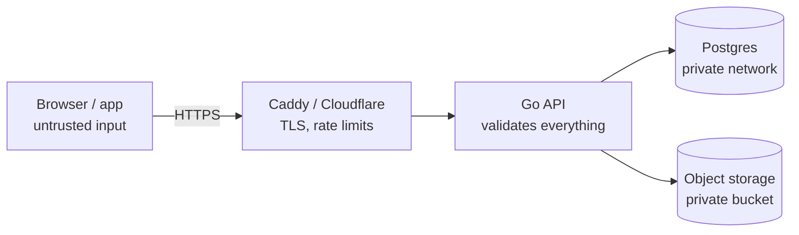

# Security

Security is a learning track that runs through all four steps, like i18n and testing ([0015](../decisions/0015-security-learning-track.md)). Every control in daybook should answer one question: **which threat does this stop?** Each milestone chapter has a *Security* part, and each step ends with a written security review.

Baselines: the [OWASP Top 10](https://owasp.org/Top10/), the [OWASP ASVS](https://owasp.org/www-project-application-security-verification-standard/) (aiming for level 1 in step 1, level 2 by step 2) and the [OWASP Cheat Sheets](https://cheatsheetseries.owasp.org/).

## Threat model
**What's worth protecting:** accounts (email, password hash, sessions), people's tasks and notes (private by nature), uploaded files (photos can reveal locations), and the server itself.

**Who might attack, and how:**

| Attacker | Example | Main defences |
|---|---|---|
| Anonymous internet | Password guessing, scanning for known bugs, malicious uploads | Rate limits, argon2id, patched dependencies, upload checks |
| Another logged-in user | Changing `:id` in a URL to read someone else's task | `user_id` on every query, 404 not 403, composite foreign keys |
| A malicious website | A hidden form that posts to daybook while I'm logged in (CSRF) | `SameSite=Lax` cookie + `Origin` check |
| Script in the page (XSS) | A task title containing `<script>` | Vue's escaping, no `v-html` on user content, CSP |
| Stolen device | A phone left unlocked | Sessions listed and revocable, Keychain on Apple |
| Leaked database dump | A backup file ends up public | Only hashes of passwords and session tokens, encrypted backups |
| Compromised dependency or CI | A package update ships malware | Lockfiles, Dependabot, least-privilege CI tokens |

## Trust boundaries

Everything that crosses an arrow from the left is untrusted until the API has checked it. The frontend's checks are for user experience only. **The server repeats every check.**

## Checklists by area
- [backend.md](backend.md): the Go API (step 1)
- [frontend.md](frontend.md): the Vue app (step 1)
- [files.md](files.md): uploads and downloads (step 1, M4)
- [cloud.md](cloud.md): servers, containers, TLS, backups (step 2)
- [native-apps.md](native-apps.md): iOS and macOS (steps 3–4)
- [ci-and-supply-chain.md](ci-and-supply-chain.md): GitHub Actions and dependencies (all steps)

## Step checkpoints
At the end of each step, go through the checklists that apply, tick what's done, and write up in the step's chapter what was found and fixed:

| Step | Checklists |
|---|---|
| 1 | backend, frontend, files, CI |
| 2 | cloud, CI, and a re-check of backend headers and cookies behind the proxy |
| 3–4 | native apps, and a re-check of bearer-token handling on the backend |

Glossary: [concepts/security.md](../concepts/security.md).
